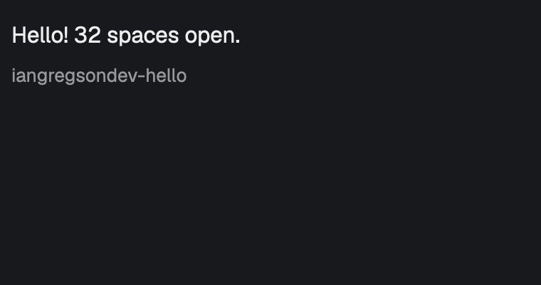

# hello

A small panel docked on the right of the window that says how many spaces are open, such as "Hello! 3 spaces open.", with its own mod id, `iangregsondev-hello`, underneath. It is the example mod for this repo: the smallest working mod, and the one to copy when starting a new one.

## What you see

- One panel, docked on the right, 240px wide, titled `hello`.
- The panel's background is the theme's `surface` colour, with 10px padding all round.
- One line of text at the top, 13px, in the theme's `foreground` colour:
  - no spaces: "Hello! No spaces open."
  - one space: "Hello! 1 space open."
  - more: "Hello! N spaces open."
- Below it, 4px down, the mod id `iangregsondev-hello` at 11px in the theme's `muted` colour.

## How it behaves

- The count follows the spaces as they open and close.
- Nothing is clickable, and it has no keys, hovers or animation.
- It follows the theme: switching themes recolours it.

## Built from

- `mod.json`: `{ "place": "right", "size": 240, "title": "hello" }`.
- The folder, and so the mod id, is `iangregsondev-hello`: the `iangregsondev-` namespace keeps it from clashing with other mods. The id is written into `main.js` at build time as a plain string.
- `main.js` default-exports a class extending `View` from `gpui-kit`. `render()` returns a `v_flex()` from `gpui-base` with `.size_full().p(10).bg(theme().surface).text_color(theme().foreground).text_size(13).gap(4)`, the greeting text as its first child, and a `div()` from `gpui-kit` with `.text_size(11).text_color(theme().muted)` holding the mod id as its second.
- `herdr` functions: `spaces()` for the count and `theme()` for the colours. It runs no programs, reads no files and makes no network calls.
- The text comes from a pure function, `greeting(spaceCount)`, kept in its own module with no `herdr` or `gpui` imports so it can be unit-tested.

## Watch out

- `theme()` is typed as plain strings, but the style methods want hex colours (`#rrggbb`); cast it.
- Plural rule: exactly 1 is "space", everything else (including 0, which has its own wording) is not.

## Done when

- `herdr-app check ~/.config/herdr-app/mods/iangregsondev-hello` passes.
- The mod id shows under the greeting.
- The panel appears on the right and shows the current number of open spaces.
- Opening or closing a space changes the number.
- With exactly one space open, it says "1 space", not "1 spaces".
