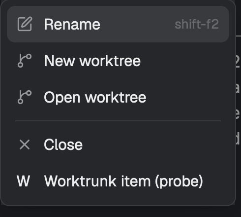

# menu-probe

A throwaway prototype, not a mod to install. It answers one question: can a mod load Herdr's own `new-menu` and `menu` mods at run time and add items to them? A panel lists each way of loading another mod's code and whether it worked; two buttons open Herdr's menus wrapped by this mod, with one extra item at the bottom.

## What you see

- A panel docked on the right, 360px wide, titled `menu-probe`.
- One line per probe, `OK` (theme `done` colour) or `NO` (theme `blocked` colour), with the result or error under it in `muted`.
- Two buttons: "Open wrapped + menu" and "Open wrapped space menu".

## How it behaves

- On load it tries, in order: `import("./control.js")` (its own file), `import()` of Herdr's `new-menu` by relative, app-home, absolute, `file://` and bare paths, a `data:` URL, `eval`, `new Function`, `readTextFile` of Herdr's file, and a runtime copy: read Herdr's `mods/<mod>/main.js`, write it unchanged to `.herdr-<mod>.js` in this mod's own folder, and `import("./.herdr-<mod>.js")`.
- The buttons (or `menu-probe.open-new`, `menu-probe.open-menu`) open this mod as a popup in a `new-menu` or `menu` role. The popup copies the Herdr class's helper methods onto itself, runs its `init`, calls its `render`, and appends one item that posts a toast.

## Built from

- `mod.json`: `{ "place": "right", "size": 360, "title": "menu-probe" }`; `control.js` as the control import.
- `herdr`: `appHome`, `readTextFile`, `openOverlay`, `closeOverlay`, `props`, `nextCommand`, `notify`, `spaces`, `theme`; `fs/promises` to read and write the copy.

## Watch out

- The popup needs the panel to have run first: the loaded classes live in module scope, shared by every copy.
- The copy is hidden (leading dot), so writing it does not make Herdr reload the mod.

## Done when

- `herdr-app check` passes, and the panel shows which probes pass.
- Both buttons open Herdr's own menu items with the probe item appended.
