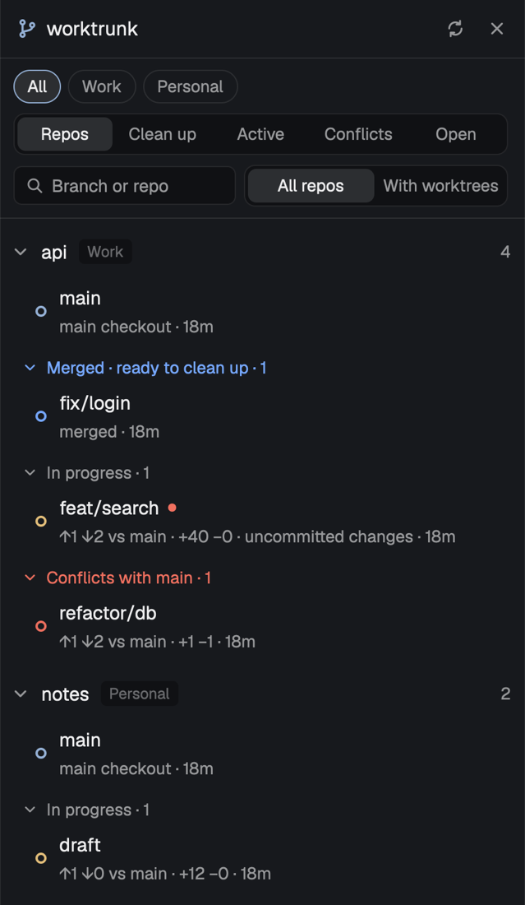

# worktrunk

A panel docked on the right of the window that lists your git repos and their [worktrunk](https://github.com/max-sixty/worktrunk) (`wt`) worktrees, grouped by what to do next: the main checkout, then Merged (ready to clean up), In progress, and Conflicts with main. Each worktree shows how far it is from main, how it was merged, and whether a space is open on it; a click goes to that space or opens a new one. Its mod id is `iangregsondev-worktrunk`.

## What you see

- One panel docked on the right, 380px wide, titled `worktrunk`, on the theme's `background` colour. Text sizes follow the layout's `ui_font_size` (base, default 13): title base+1, body base+0.5, sublines base-1.
- **Header**, 42px high, a `border` line under it: a git-branch icon in `accent`, the word "worktrunk" (semibold), a turning ring while it reads, then two 24px icon buttons in `muted`: refresh and close. Close shows only when the panel has its own block in the layout.
- **Banners**, each one line on `selected` in `blocked`, only when something outside any one repo went wrong:
  - the settings file doesn't parse, can't be read, or couldn't be created from the old file: "iangregsondev-worktrunk.json: <what is wrong> — using defaults until it's fixed.";
  - the search for repos failed (the folder scan or the open spaces' lookup): "Couldn't look for repos: <last error line>". The repos from the last search that worked stay listed.
- **Controls**, under the banners on a `border` line, 12px side padding, 7px apart:
  - **Group chips**, wrapping: "All", then one per group in Settings order, then any other group names sorted, then "Other" for repos in no group folder. A group with no repos gets no chip. Chips are 24px pills: the selected one has an `accent` border, `selected` background and semibold `foreground` text; the rest a `border` border and `muted` text. Before the first scan the chips come from Settings, so a saved chip doesn't flash back to All.
  - **View picker**, a full-width segmented control on `chrome`: Repos, Clean up, Active, Conflicts, Open. The selected segment is `raised`, semibold, `foreground`.
  - **Search box**, 28px on `chrome` with a search icon and the placeholder "Branch or repo". In the Repos view, a 190px "All repos / With worktrees" segmented control sits beside it.
- **The Repos view**, scrolling, one entry per repo of the selected group, sorted by folder name:
  - A repo line: a chevron (down when open, right when folded), the repo's folder name (semibold), its group as a small badge on `chrome` in `dim` (not shown for Other), and on the right its worktree count in `muted` ("…" before its first read).
  - Under it, "Reading…" in `muted` before the first read, or the last error line of `wt list` in `ansi1` when a read failed (rows from the read before stay). When the latest CI read failed: "CI status not updated: <reason>" in `muted` (the CI from before stays).
  - The main checkout's row, then each group that has rows, as a line "Merged · ready to clean up · N" (`done`), "In progress · N" (`muted`) or "Conflicts with main · N" (`blocked`) with its own chevron. Rows in a group are newest commit first.
  - A row, 40px: an 8px dot, the branch name ("(detached)" with no branch) with a 6px `blocked` dot after it when there are uncommitted changes, a subline in `muted` under it, then on the right a 13px CI icon and "open" when a space sits on it. The row has a `selected` background when that space is the shown one.
- **The flat views** (Clean up, Active, Conflicts, Open): one list of rows across the selected group's repos, newest commit first, each subline starting with the repo's folder name. Clean up lists merged worktrees under a `done` line "N merged in M repos" ("1 repo" for one); Active lists in-progress ones; Conflicts lists those that would conflict with main; Open lists every worktree a space sits on, main checkouts included. Empty: "Nothing to clean up.", "No worktrees in progress.", "No worktrees conflict with main." or "No worktree has a space open."; "Reading…" while a repo is still unread.
- **CI icons:** a check in `done` (passed), a turning ring in `working` (running), an alert in `ansi1` (failed), an alert in `blocked` (the forge says the PR conflicts), a question mark in `muted` (the forge gave no answer). Checks that ran on an older commit than the one pushed are drawn in `dim`. No icon before the first CI read, or when there is no PR and no checks.
- **Dot colours:** main checkout `accent`, merged `done`, in progress `working`, conflicts `blocked`. Solid when a space is open on the worktree, hollow (a 1.5px ring) when none is.
- **Sublines**, parts joined by " · ", ending with the age of the last commit (`5m`, `3h`, `2d`, `4mo`):
  - main checkout: "↓N behind remote" and "↑N to push" when they apply, else "main checkout";
  - merged: "same files as main", "squash-merged", "in main's history", or "merged" for any other reason;
  - in progress and conflicts: "↑ahead ↓behind vs main", "+added −deleted" when any lines changed, "↓N remote" when behind its upstream;
  - then "uncommitted changes" when dirty.
- With no repos: "Looking for repos…" during the first scan; "No repos yet. Add your repo folders to iangregsondev-worktrunk.json in Herdr's folder." with no group folders set; else "No repos found in your group folders." When the search or the toggle leaves the Repos view empty: `Nothing matches "<search>".` while searching (the flat views say the same), else "No repos with worktrees here. Choose All repos to see the rest."

## How it behaves

- **Click a row:** switches to the space on that worktree (`space.select {id}`), or opens a new space on its folder (`space.new {name, folder}`), named after the branch, or after the repo for the main checkout.
- **Click a repo line or a group line:** folds or unfolds it. Folding is remembered across restarts.
- **Group chip:** lists only that group's repos, in every view, and reads them again, CI included, since they may not have been read yet. A chip picked while the panel is hidden is read when it shows again. A saved chip whose group no repo is in any more falls back to All.
- **View picker:** switches between the Repos tree and the flat views.
- **Search:** ignores case and spaces around the text; keeps worktrees whose branch or repo folder name holds it, in every view. In the Repos tree a repo with no match drops out (a repo not read yet stays only when its name matches), and folded repos and groups open while searching; folding comes back when the box is cleared. A space on a worktree the search hides never shows on another row. The search isn't remembered.
- **All repos / With worktrees** (Repos view only, With worktrees by default): With worktrees hides repos that have only a main checkout, counting from the last `wt list` (the scan's count before that). The flat views ignore it.
- **Remembered:** the chip, view and toggle are kept in shared key `iangregsondev-worktrunk.view.v1` as `{ "group": <name or null>, "show": "repos"|"merged"|"active"|"conflict"|"open", "only": <bool> }`, so they survive a restart; a field that can't be read falls back to its default.
- **Refresh button:** reads everything again, folder scan and CI included. The ring turns while reading.
- **Close button:** hides the panel (`layout.hide` on its block).
- **By itself:** reads the list when the panel first shows and when it shows again, then every 20 seconds while it shows. The folder scan reruns every 10 minutes, or at once when the folders, depth or skip names change. Settings are re-read on every refresh, so hand edits apply within 20 seconds. CI is read after the first refresh and then once a refresh finds the last CI read older than 5 minutes, on its own so it never holds up the list; a CI read already running is never started twice. Only the selected group's repos are read. Lists are read 6 repos at a time and CI 3 at a time, so Herdr doesn't run out of open files.
- **Space matching:** a space sits on a worktree when its place (its first pane's live folder, else the folder it was made in) is inside that worktree's folder; the longest matching worktree path wins, so nested worktrees match correctly. When several spaces sit on one worktree, the shown one wins. Spaces on other machines are ignored.
- **Tab-bar toggle:** a layout block `{ "mod": "iangregsondev-worktrunk", "props": { "role": "toggle" } }` draws a 112px strip on `chrome` with a `border` line under it, holding one pill button (git icon and "worktrunk", 26px high): `selected` with `foreground` text while the panel shows, else `chrome` with `muted` text. A click runs `layout.toggle` on the panel's block. The panel's block is the first block of this mod with no `role` (or `role: "panel"`), so the toggle never finds itself; a block naming a role the mod doesn't have draws nothing. The `iangregsondev` layout built by the repo's `vp run herdr:sync` places it at the end of the tab bar.
- **Herdr update toast:** when `~/.config/herdr-app/iangregsondev-sync.json` (written by `herdr:sync`) names a Herdr version other than the installed one (`updates().app.version`), the panel shows one `warning` toast, "Herdr updated: run herdr:sync". It remembers the version it told you about (shared key `iangregsondev-worktrunk.sync-told.v1`), so it shows once per version. No record, or one that can't be read, no toast.
- **Agent status:** not shown; the panel is about worktrees, not agents.

## Built from

- `mod.json`: `{ "place": "right", "size": 380, "title": "worktrunk", "focusable": true }`. Icons are this mod's own SVGs (`git`, `sync`, `close`, `chevron-down`, `chevron-right`, `ring`, `search`, `check`, `alert`, `help`), drawn with `svg("mods/iangregsondev-worktrunk/<name>.svg")`.
- `main.js` default-exports a `View` (from `gpui-kit`, with `h_flex`/`v_flex`, `Input` and `InputState` from `gpui-base`). A pure view builder turns a snapshot (repos, each repo's list and CI, settings, `spaces()`, `panes()`, folded state, view state, search text, now) into what the panel draws; `render` only turns that into elements. Every call to `exec` and the file functions goes through an Effect service (`Shell`, `Files`) with tagged errors, and each failure becomes something the panel shows: a banner, or a repo's error line.
- `herdr` functions: `exec`, `readTextFile`, `writeTextFile`, `appHome`, `home`, `spaces`, `panes`, `layout` (to find its own block and whether it is hidden), `theme`, `settings`, `shared`/`setShared` (keys `iangregsondev-worktrunk.folded.v1`, `iangregsondev-worktrunk.view.v1` and `iangregsondev-worktrunk.imported.v1`), `run` (`space.select`, `space.new`, `layout.hide`).
- **Programs it runs**, all through `sh -c` with the inputs as arguments (`$1`...), and with `~/.local/bin`, `/opt/homebrew/bin` and `/usr/local/bin` appended to `PATH`:
  - the folder scan: walks each group folder down to the depth, never into a repo, a symlink, a hidden folder or a skipped name; a folder with a `.git` folder is a repo, and its worktrees are counted from `.git/worktrees/`;
  - the open spaces' repos: `git rev-parse --path-format=absolute --git-common-dir` for each space's place, whose parent is the repo, and `git worktree list --porcelain` for the count;
  - `wt list --format=json` in each repo of the selected group (60s timeout);
  - `wt list --format=json --full` for CI in the same repos (240s timeout, since `--full` asks the forge about every branch). A failed CI read is named "wt list --full" in its note.
- **Files:** settings in `~/.config/herdr-app/iangregsondev-worktrunk.json`: `{ "folders": [{ "name": "Work", "path": "~/code/work" }], "depth": 4, "skip": ["node_modules", ".cache"] }`. Missing keys take those defaults; a folder with no name is named after its last path segment; depth is kept to 1–8. On first run, when that file doesn't exist and the older `worktrunk` mod's `~/.config/herdr-app/worktrunk.json` parses, its settings are copied into a new file once. The panel records that in shared state (`iangregsondev-worktrunk.imported.v1`, also set when it first finds the new file), so deleting the new file later gives the defaults, never a second import. If another settings file appears while it copies, that file is used. The old file is only read.

## Watch out

- It runs programs (`sh`, `git`, `wt`) and reads files outside its folder (your repos, the settings file). It needs `wt` installed.
- Effect's `Schema` can't be used: it builds a `TextEncoder` when it loads, and Herdr's runtime has none, so the mod fails to load. JSON is read with small `Predicate`-based readers instead.
- A repo is a folder with a `.git` folder: a linked worktree (whose `.git` is a file) is never listed as a repo of its own.
- `wt list --format=json` prints `{ "items": [...] }` (schema 2); an older wt printed a bare array. Both are read. Items without a `worktree.path` are skipped; any field may be missing or `null`.
- Merged means wt's `display.state` is `integrated` or `empty`; conflicts mean `would_conflict`. A dirty worktree at main's commit (`same_commit`) is in progress.
- Every shared-state key and the settings file are named with the mod id, so it runs beside the older `worktrunk` mod without either touching the other's state.
- Every repo of the selected group is read on each refresh; with many repos that is many `wt` processes every 20 seconds. Choose a group chip to read fewer.
- CI comes from `wt list --full`, which needs a forge token in the environment Herdr runs programs with. Without one, wt reports no PR and no checks for every branch, which looks the same as having no CI. Where wt says it asked but got no answer (`pr` or `checks` `null`, or a `null` check status), the row shows the question mark rather than nothing. Without `--full`, wt doesn't collect CI at all (`collected.ci` is false), so a plain `wt list` never shows an icon.

## Done when

- `herdr-app check ~/.config/herdr-app/mods/iangregsondev-worktrunk` passes.
- With group folders set, each repo in them shows with its group badge and worktree count; a repo of an open space outside them shows with no badge.
- A repo's main checkout comes first, then Merged, In progress and Conflicts, each with its count, and folding a repo or a group survives a restart.
- The chips read All, your groups in Settings order, then Other; choosing one lists only its repos. The view picker switches to flat Clean up, Active, Conflicts and Open lists. Typing a branch or repo name narrows every view. With worktrees hides single-checkout repos. The chip, view and toggle are the same after a restart.
- A worktree with a PR whose checks passed shows a check icon within 5 minutes of the panel showing.
- A worktree with an open space has a solid dot and "open"; the shown space's row is highlighted; clicking it switches to that space. Clicking a worktree with no space opens a new space on its folder.
- A broken settings file shows the banner and the panel still lists repos from the defaults.
- On a first run with only `worktrunk.json` present, `iangregsondev-worktrunk.json` appears with the same folders, and `worktrunk.json` is unchanged.
- Deleting `iangregsondev-worktrunk.json` after that leaves the panel on the defaults; the old settings are never copied again.
