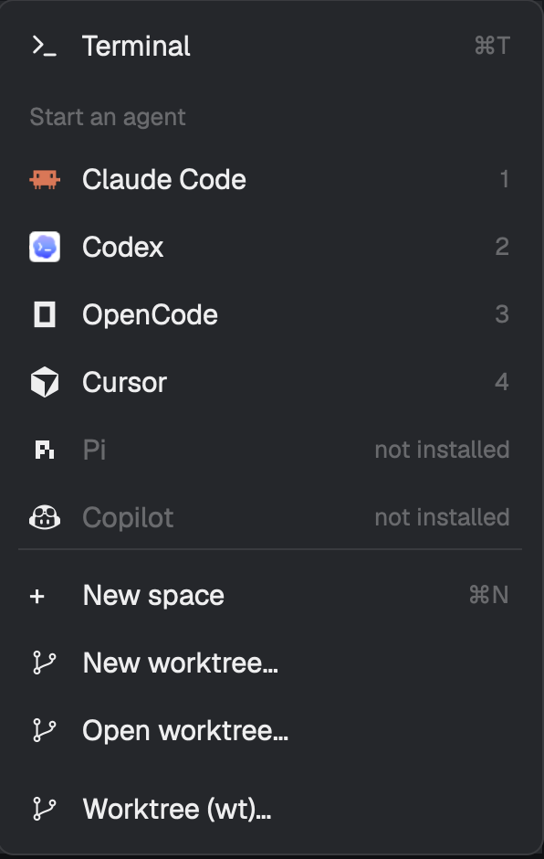

# menus (wt)

Version 0.0.0 · [Changelog](https://github.com/iangregsondev/herdr-mods/blob/main/apps/menus/CHANGELOG.md)

Herdr's own tab bar, sidebar, "+" menu and space right-click menu, looking exactly as Herdr draws them, with worktrunk items added: "Worktree (wt)…" just after the "+" menu's worktree rows, and "Worktree (wt)…", "Merge into main (wt)…" and "Remove worktree (wt)…" in a space's menu, just after Herdr's own worktree items. The items hand their work to the worktrunk panel (`iangregsondev-worktrunk`). Installed as `iangregsondev-menus`.

## What you see

- **Tab bar and sidebar:** unchanged from Herdr's `tabs` and `spaces`: same sizes, colours, icons and behaviour, because they are Herdr's own code.
- **"+" menu** (the tab bar's "+" button): Herdr's whole menu (Terminal, Start an agent, New space, New worktree…, Open worktree…), with one more row, "Worktree (wt)…", just after Herdr's last worktree row (found by its id, `worktree…`, or a label with "worktree"), so rows Herdr adds later stay after it. It has this mod's own branch icon (`branch.svg`, 14px) and Herdr's row style (31px high, theme `foreground`, `selected` on hover). Greyed (`dim`) when no space is active. The popup is 250×548px (Herdr's 512px plus the row); the menu is Herdr's height plus the row, so every agent still shows. With no worktree row to follow, the row goes after Herdr's last row and a warning toast names the patch point.
- **Space right-click menu**, Herdr's items in Herdr's order, with ours inserted after Herdr's last worktree item (else before Close, else last):
  - a space on a linked worktree: Rename, New worktree, Open worktree, Remove worktree, **Worktree (wt)…**, **Merge into main (wt)…**, **Remove worktree (wt)…**, Close;
  - a space on a repo's main checkout: Rename, New worktree, Open worktree, **Worktree (wt)…**, Close;
  - a space outside git, or before Herdr's git check answers: Herdr's items only.
  - Our rows use Herdr's branch icon and look like Herdr's. The popup is 200×353px (Herdr's 260px plus three rows).
- Tab right-click menus and the terminal menu are Herdr's, untouched.

## How it behaves

- **"+" → Worktree (wt)…:** opens worktrunk's New or open worktree dialog for the focused pane's repo (outside a repo, the dialog asks for one).
- **Space menu → Worktree (wt)…:** the same dialog for that space's repo, offering the branch the space is on as a base.
- **Space menu → Merge into main (wt)… / Remove worktree (wt)…:** worktrunk's confirm dialog, then its usual merge (squash) or remove job in a terminal window, one job at a time; spaces left on the removed folder close. The main checkout, a detached worktree's merge, a space with no folder here, or a failed lookup get a warning toast from worktrunk instead, saying why.
- Our space-menu items work with the mouse and with Herdr's keys (↑/↓, Enter).
- When the worktrunk panel is hidden, an item shows it first; with no worktrunk panel in the layout, a warning toast says so and nothing runs.
- Herdr's new menu items, and fixes to these four mods, appear by themselves: the mod reads Herdr's installed code each time it loads.
- **When Herdr's code can't be shown** (its mod isn't installed, a file can't be read or written, the copy won't load or has no view class), the menus open Herdr's own menu instead, and the tab bar or sidebar shows the one-line reason with an error toast that says to switch to Herdr's own layout.

## Built from

- `mod.json`: `{ "place": "none", "title": "menus (wt)" }`. One mod plays four roles, from `props.role`:
  - layout blocks `{ "mod": "iangregsondev-menus", "props": { "role": "tabs" } }` and `{ ..., "role": "spaces" }`, in place of Herdr's `tabs` and `spaces` blocks;
  - popups `{ role: "new-menu" }` and `{ role: "menu", tab: "space", target: { id } }`, opened by those two.
- **Copying Herdr's code at run time:** a mod can't import another mod's files (refused as outside its folder) and `eval` is disabled, but it can import its own files. So each role reads `<app home>/mods/<herdr mod>/main.js` (`readTextFile`), writes it, patched, to `.herdr-<herdr mod>.js` in this mod's folder (`writeTextFile`, only when the text changed, over the text it held; hidden files don't trigger a reload), and `import()`s that with a variable specifier. Its default export is Herdr's View class. Every one of these calls goes through an Effect service with a tagged error for each way it fails (`Files` from `worktrunk-mailbox`, `Modules` in `copies.ts`).
- **Patches** (exact text, each must occur exactly once, else the copy is Herdr's file unchanged and a warning toast names the patch point and how often it was found):
  - `tabs`: `openOverlay({ mod: "new-menu", kind: "popup", width: 250, height: 512 })` → this mod, `height: 548`, `props: { role: "new-menu" }`.
  - `spaces`: `openOverlay({ mod: "menu", kind: "popup", width: 200, height: 260, props: { tab: "space",` → this mod, `height: 353`, `role: "menu"` added to the props.
  - `menu`: `function items(p, git) {` renamed, and a new `items(p, git)` appended that runs Herdr's list through our extension and is exported, with a setter for the extension.
  - `new-menu`: `.w_full().h(Math.min(491, ` → `.w_full().h(31 + Math.min(491, `, so the menu has room for our row inside it. When it misses, the "+" menu is Herdr's own, without our row.
- **Playing Herdr's view:** the copy's class (or a subclass: `menu` overrides `choose` so our items post a request and Herdr's go to Herdr's `choose`; `new-menu` overrides `row` and `render`: `render` runs Herdr's once to list its rows, picks the last worktree row, then runs it again with `row` drawing ours, through Herdr's own `row()`, just after that one) has its methods bound onto this mod's instance, then its `init` and `render` are called with that instance.
- **Talking to worktrunk:** a request `{ id, action }` in shared state under `iangregsondev-worktrunk.request.v1` (`setShared`), with `action` `{ _tag: "NewOrOpen", folder: null }` or `{ _tag: "SpaceWorktree", space, act: "NewOrOpen" | "Merge" | "Remove" }`. A hidden panel is shown first with `layout.show`. The request types and the panel lookup live in this repo's `packages/worktrunk-mailbox`, which both mods bundle.
- `herdr` functions: `appHome`, `readTextFile`, `writeTextFile`, `props`, `layout`, `spaces`, `setShared`, `run("layout.show")`, `openOverlay`, `closeOverlay`, `notify`, `theme`. It runs no programs itself; worktrunk runs the jobs.
- **Your layout** points at these roles through this repo's `vp run herdr:sync`, which rebuilds the `iangregsondev` layout from Herdr's `main` and swaps the `tabs` and `spaces` blocks for this mod, only when it is installed.

## Watch out

- It needs this repo: the layout comes from `herdr:sync`, and the items need the worktrunk mod. Installing only this folder changes nothing until a layout names it.
- Run `herdr:sync` after installing or removing it, and after every Herdr update. `vp run dev:remove menus` leaves the synced layout as it is, so its tab bar and sidebar blocks name a missing mod until the dev build runs again or the sync puts Herdr's back.
- Herdr's `init` must run in this mod's own `init`, not in a task: a task's context drops the tasks Herdr's `init` starts (the space menu's git check never answers). So the tab bar and sidebar load the menus' code early, and a menu opened before it is loaded closes and opens again once it is.
- Don't mount Herdr's view as a nested `cx.new(...)` entity: it is released on reload and as a child of another element ("this Entity has been released").
- The copies are hidden files next to `main.js`; installers comparing folders by hash see them as extra files.
- Herdr's `tabs` keeps its panels choice in `localStorage`, which is per mod, so the wrapped tab bar starts without Herdr's saved choice.
- Only the space menu from the sidebar and the tab bar's "+" are ours; a tab's right-click and the Terminals layout's bar still open Herdr's own menu.

## Done when

- `herdr-app check` passes on the mod folder.
- With `herdr:sync` run, the tab bar and sidebar look and work as Herdr's.
- "+" shows Herdr's items with "Worktree (wt)…" just after "Open worktree…", every agent row showing; choosing it opens the New or open dialog for the focused repo.
- A linked-worktree space's menu shows Herdr's worktree items, then the three (wt) items, then Close; a main-checkout space shows only "Worktree (wt)…"; a non-git space shows none.
- Merge and Remove open worktrunk's confirm dialog for that worktree.
- Changing a patch point's text in a copy of Herdr's file shows a toast naming it, and the menus fall back to Herdr's.
