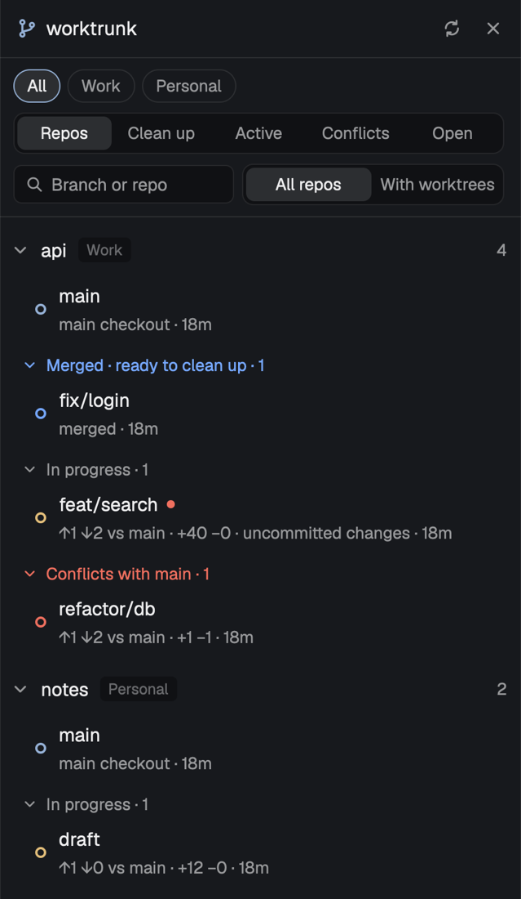

# worktrunk

Version 0.0.0 · [Changelog](https://github.com/iangregsondev/herdr-mods/blob/main/apps/worktrunk/CHANGELOG.md)

A panel docked on the right of the window that lists your git repos and their [worktrunk](https://github.com/max-sixty/worktrunk) (`wt`) worktrees, grouped by what to do next: the main checkout, then Merged (ready to clean up), In progress, and Conflicts with main. Each worktree shows how far it is from main, how it was merged, and whether a space is open on it; a click goes to that space or opens a new one. Its mod id is `iangregsondev-worktrunk`.



## What you see

- One panel docked on the right, 380px wide, titled `Worktrunk`, on the theme's `background` colour. Text sizes follow the layout's `ui_font_size` (base, default 13): title base+1, body base+0.5, sublines base-1.
- **Header**, 42px high, a `border` line under it: a git-branch icon in `accent`, the word "Worktrunk" (semibold), a turning ring while it reads, then four 24px icon buttons in `muted`: new or open worktree (a plus), settings (sliders), refresh and close. Close shows only when the panel has its own block in the layout.
- **Banners**, each one line on `selected` in `blocked`, only when something outside any one repo went wrong:
  - the settings file doesn't parse, can't be read, or couldn't be created from the old file: "iangregsondev-worktrunk.json: <what is wrong> — using defaults until it's fixed.";
  - the search for repos on this machine failed (the folder scan or the open spaces' lookup): "Couldn't look for repos: <last error line>". The repos from the last search that worked stay listed;
  - a group folder doesn't exist, one banner each, after the others: "Group folder <folder, ~ expanded> doesn't exist, so it lists no repos." The other group folders' repos still show;
  - another machine that can't be read now, one banner each, after the others: "<machine>: connecting…" while Herdr's machine list (`machines()`) says its layout is still `loading`, or "Can't reach <machine>: <reason>" when it says `unavailable` ("Herdr can't reach it") or a search or list read run there fails (its last error line). That machine's repos aren't listed or read until it answers again, so none show stale; this machine's repos never wait on it. A run Herdr refuses because every exec slot on that machine is taken ("… execs are running already") is busy, not down: no banner, and the machine's last search and lists stay until a later refresh gets a slot. Only a machine with no search that worked yet shows the refusal as its banner.
- **Controls**, under the banners on a `border` line, 12px side padding, 7px apart:
  - **Filter row**: two dropdown buttons side by side, sharing the row's width, so it never grows with the number of machines or groups. Each is 26px on `chrome` with a `border` outline, the current choice in `foreground` and a chevron-down in `muted` at the right; clicking it opens a popup menu of its choices (like the row menu, titled "Machine" or "Group"), the current one with a check in `accent`.
    - **Machine filter**, first, shown only when repos or group folders sit on more than one machine (the group filter sits alone on the row otherwise): "All machines", then "this machine", then each other machine by Herdr's name for it. It starts at All machines.
    - **Group filter**: "All groups", then one per group in Settings order, then any other group names sorted, then "Other" for repos in no group folder. A group with no repos (on the filtered machine) isn't offered. Before the first scan the groups come from Settings, so a saved group doesn't flash back to All groups.
  - **View picker**, a full-width segmented control on `chrome`: Current, Repos, Clean up, Active, Conflicts, Open. The panel starts on Repos. The selected segment is `raised`, semibold, `foreground`.
  - **Search box**, 28px on `chrome` with a search icon and the placeholder "Branch or repo". In the Repos view, a 190px "All repos / With worktrees" segmented control sits beside it.
- **The Repos view**, scrolling, one entry per repo of the selected group, sorted by folder name:
  - A repo line: a chevron (down when open, right when folded), the repo's folder name (semibold), its machine as a small badge with a `border` outline in `muted` (Herdr's name for it, or "this machine"; shown only while the list holds repos on more than one machine, so never while the machine filter picks one), its group as a small badge on `chrome` in `dim` (not shown for Other), and on the right its worktree count in `muted` ("…" before its first read).
  - Under it, "Reading…" in `muted` before the first read, or the last error line of `wt list` in `ansi1` when a read failed (rows from the read before stay). When the latest CI read failed: "CI status not updated: <reason>" in `muted` (the CI from before stays).
  - The main checkout's row, then each group that has rows, as a line "Merged · ready to clean up · N" (`done`), "In progress · N" (`muted`) or "Conflicts with main · N" (`blocked`) with its own chevron. Rows in a group are newest commit first.
  - A row, 40px: an 8px dot, the branch name ("(detached)" with no branch) with a 6px `blocked` dot after it when there are uncommitted changes, a subline in `muted` under it, then on the right a 13px CI icon and "open" when a space sits on it. The row has a `selected` background when that space is the shown one.
  - A repo line with merged worktrees also shows a small "Clean up" button in `done` before its count.
- **The flat views** (Clean up, Active, Conflicts, Open): one list of rows across the selected group's repos, newest commit first, each subline starting with the repo's folder name (`<machine>: <name>` while the list holds repos on more than one machine). Clean up lists merged worktrees under a `done` line "N merged in M repos" ("1 repo" for one); Active lists in-progress ones; Conflicts lists those that would conflict with main; Open lists every worktree a space sits on, on any machine, main checkouts included. Empty: "Nothing to clean up.", "No worktrees in progress.", "No worktrees conflict with main." or "No worktree has a space open."; "Reading…" while a repo is still unread.
- **Clean up all:** in the Clean up view, a "Clean up all N" button in `ansi1` at the right of the "N merged in M repos" line. It removes exactly the worktrees the view lists, so the group filter and the search narrow it.
- **Footer**, 36px, a `border` line above it, only while a job runs: a turning ring in `working` and "Running: <job>" in `muted`.
- **Row menu** (right-click a worktree), a popup 250px wide on `popover`: the branch name in `muted` as a 28px title, then 30px items: "Open", "Merge into main (squash)", "Merge, keeping every commit", "Remove…" (in `ansi1`), "Copy path", "Reveal in Finder". The main checkout has only Open, Copy path and Reveal; a detached worktree has Remove but no merges. A repo on another machine has no Reveal in Finder, here or in the repo menu. Its height is 40px plus 30px per item.
- **Repo menu** (right-click a repo line): the repo's folder name, then "New or open worktree…" (the dialog below, for this repo), "Clean up N merged…" (in `ansi1`, only when some are merged), "Refresh", "Reveal in Finder", "Hide this repo". Sized the same way.
- **Confirm dialog**, 500px wide, before a merge, a remove or a clean up: a title ("Merge feat into main?", "Remove feat?" (the folder's name for a detached worktree), "Remove 3 merged worktrees?"), lines in `muted` saying what happens (one commit, or every commit kept; the branch goes too; each repo's worktrees for a clean up; a warning for uncommitted changes; spaces on removed worktrees close), then Cancel on `raised` and the go button on `accent` (`ansi1` for a remove or a clean up). Its height is 132px plus 22px per line, up to 560px.
- **New or open worktree dialog**, 540x440 on `popover`, from the header's plus button, the repo menu, the `new` key, or "New worktree (wt)…" in a space's menu. It works in the repo on its own machine: lookups, reads and the job all run there.
  - Title "New or open worktree in <repo>" ("… in <repo> on <machine>" for a repo on another machine), then a 32px input with an `accent` border ("Branch name, pr:123 or a PR link").
  - Under it a scrolling list of at most 50 lines, 30px each, the highlighted one on `hover`. With nothing typed it lists the repo's worktrees (a solid `working` dot, "open worktree"), then local branches with no worktree ("branch: new worktree"), then branches only on `origin` ("on origin: new worktree"), each a hollow `muted` dot. Typing narrows it to names holding the text, ignoring case: exact match first, then names starting with it, then the rest, worktrees before branches. Unless a name matches exactly, the first line is the typed text with a plus in `accent` ("new branch"). `pr:N`, `mr:N` or a PR/MR link lists only itself ("ask wt"). "Reading worktrees and branches…" until the repo is read. A `wt list` or branch list that fails shows its last line in `ansi1` (both, joined by " · ", when both fail); whatever did read is still listed, and typed names still work.
  - "New branch from" with two pills: "Default branch", and "<branch> (the branch I'm on)" when the folder it opened for is on a branch. Default branch is chosen first.
  - A `dim` hint line: "↑↓ choose · Enter opens or creates it · Tab switches the base · Esc closes".
  - **No Current repo** (the folder it opened for is outside every repo): the title reads "New or open worktree: pick a repo", the input "Repo name", and the list the panel's repos on every machine by folder name (with their `~` path on this machine, "<machine>: <path>" on another), narrowed as you type the same way. Enter or a click picks one, and the dialog goes on as above for that repo, with only "Default branch" as the base. With no repo at all, no dialog: a `warning` toast, "No repo for a worktree". A repo or branch lookup that fails: a `warning` toast, "Couldn't find the repo for a worktree", with the reason.
- **Open a worktree dialog**, the same dialog from "Open worktree (wt)…" in a space's menu, for picking one of the repo's worktrees: title "Open a worktree of <repo>" ("… on <machine>" for another machine), input "Worktree's branch", and only the repo's worktrees (with branches), narrowed as above, each with its folder's name. No base pills, no typed line. Enter or a click selects the space on that worktree, or opens a new space on it on the repo's machine. Hint: "↑↓ choose · Enter goes to its space, or opens one · Esc closes".
- **Settings dialog**, a modal dialog 620x600 on `popover`, titled "worktrunk settings", its body scrolling when the lists outgrow it. Each section has a semibold heading and a `muted` hint line:
  - **Groups:** one row per group folder, in order: a 150px name field (its placeholder is the folder's last segment), the folder's path in `muted` (as "<machine>: <path>" for a folder on another machine), then ↑, ↓ and a close icon to move it up, down or remove it. "No group folders yet." when there are none. An "Add folder on this machine…" button under them opens the system folder picker. When Herdr's machine list (`machines()`) has other machines, a hint follows ("Or pick another machine, type the folder's path there (~ is its home) and add it."), then one chip per other machine (24px pills: the picked one has an `accent` border, `selected` background and `foreground` text; the rest a `border` border, `input` background and `muted` text), then a path field and, once a machine is picked, an "Add on <machine>" button ("Pick a machine first" before). The button checks the folder on that machine first (it reads `$HOME` there for `~`, then `[ -d ]`), showing "Checking on <machine>…"; a folder that is there joins the groups written with `~` under that home and named after its last segment; one already listed on that machine changes nothing. Otherwise nothing is added and the note says why: "Type the folder's path on <machine>", "<path> isn't a folder on <machine>", or "couldn't check <path> on <machine>: <last error line>". Save waits while a check runs.
  - **Scan:** "Depth" with − and + buttons around the number (1 to 8), and "Skip folders named", one field of comma-separated names.
  - **Hidden repos:** one row per hidden repo: its folder name, its path in `muted` (`~` for the home folder; `<machine>: <path>` for a repo on another machine), and a "Show again" button. "No hidden repos." when there are none.
  - **Shell wrapper:** a checkbox (filled `accent` when on), "Run merge, remove and clean up without my wt shell function".
  - **Footer:** "Saved in ~/.config/herdr-app/iangregsondev-worktrunk.json. You can edit it by hand too." in `dim`, then Cancel on `raised` and Save on `accent`. A save or a folder pick that didn't happen says why above it in `ansi1`.
- **Job window**, a floating window 820x460 (it remembers where you put it): a 34px title bar on `chrome` (git icon, the job's title, "drag to move" in `dim`, a "Stop" button in `ansi1`) over the job's terminal. A job that works prints "Done." in green and the window closes a second later; one that fails prints "Failed (exit N). Press Enter to close." in red and stays until you press Enter.
- **The Current view:** only the Current repo, the repo holding the folder of the focused pane, laid out like one Repos-tree entry that never folds (its chevron stays down and clicking its line does nothing; its groups still fold). The focused folder is the focused terminal's live folder, else (a mod pane or the panel has focus) the focused space's place, on the focused space's machine (a terminal on this machine that has run `ssh` still counts as this machine), and its repo is looked up there; a folder inside a linked worktree counts as that worktree's repo, and a hidden repo still shows here. It ignores the group filter and the All repos / With worktrees toggle; the search narrows it (`Nothing matches "<search>".` when nothing does, unless the repo is still unread). Outside every repo it shows "Not in a repo" in `muted`, semibold, over the Open view's list across all repos. "Finding the current repo…" until the first lookup answers; "Couldn't find the current repo: <reason>" when the lookup fails.
- **CI icons:** a check in `done` (passed), a turning ring in `working` (running), an alert in `ansi1` (failed), an alert in `blocked` (the forge says the PR conflicts), a question mark in `muted` (the forge gave no answer). Checks that ran on an older commit than the one pushed are drawn in `dim`. No icon before the first CI read, or when there is no PR and no checks.
- **Dot colours:** main checkout `accent`, merged `done`, in progress `working`, conflicts `blocked`. A New worktree (in progress) also shows a small "new" badge in `working` on `hover` after its branch name. Solid when a space is open on the worktree, hollow (a 1.5px ring) when none is.
- **Sublines**, parts joined by " · ", ending with the age of the last commit (`5m`, `3h`, `2d`, `4mo`):
  - main checkout: "↓N behind remote" and "↑N to push" when they apply, else "main checkout";
  - merged: "same files as main", "squash-merged", "in main's history", or "merged" for any other reason;
  - in progress and conflicts: "↑ahead ↓behind vs main", "+added −deleted" when any lines changed, "↓N remote" when behind its upstream;
  - then "uncommitted changes" when dirty.
- **Hover labels:** every status mark explains itself after a half-second hover, with the same text announced to a screen reader:
  - the row's dot: its state ("Main checkout", "Merged", "In progress" or "Conflicts with main"), then " · open in a space" or " · no space open";
  - the "new" badge: "No commits or changes yet"; the uncommitted-changes dot: "Uncommitted changes";
  - "open": "Open in a space", or "Open in a space on <machine>" for a repo on another machine;
  - the CI icon: "CI passed", "CI is running", "CI failed", "Conflicts with main" or "No CI status", plus " on an older commit than the one pushed" when it is dimmed;
  - the header's turning ring: "Refreshing worktrees".
- With no repos: "Looking for repos…" during the first scan; "No repos yet. Add your repo folders in Settings, or in iangregsondev-worktrunk.json in Herdr's folder." with no group folders set; else "No repos found in your group folders." When the search or the toggle leaves the Repos view empty: `Nothing matches "<search>".` while searching (the flat views say the same), else "No repos with worktrees here. Choose All repos to see the rest."

## How it behaves

- **Click a row:** switches to the space on that worktree (`space.select {id}`), or opens a new space on its folder on the worktree's machine (`space.new {name, folder}`, plus `machine` for a repo on another machine), named after the branch, or after the repo for the main checkout.
- **Click a repo line or a group line:** folds or unfolds it. Folding is remembered across restarts.
- **Group filter:** picking a group lists only its repos, in every view, and reads them again, CI included, since they may not have been read yet. A group picked while the panel is hidden is read when it shows again. A saved group no repo is in any more falls back to All groups.
- **Machine filter:** picking a machine lists only its repos, in every view (in the Current view only the Open list outside every repo), reads only those, and drops the machine labels. A saved machine that no repo or group folder is on any more falls back to All machines, once the repos are found.
- **Remembered across restarts:** the machine filter, the group filter, the view and the All repos / With worktrees toggle in one shared-state value (`iangregsondev-worktrunk.view.v1`), and the folded repos and groups in another (`iangregsondev-worktrunk.folded.v1`).
- **View picker:** switches between the Repos tree, the flat views and the Current view.
- **Group labels in the sidebar:** the panel publishes each space's group, on every machine, in shared state (`iangregsondev-worktrunk.groups.v1`, `{ <space id>: <group> }`): the group of the repo whose worktree the space sits on (the deepest one, on the space's machine). Spaces on no repo or on a repo in Other are left out. It publishes once repos are found, and only when the map changed. This repo's `menus` mod draws them as labels on the sidebar's space rows.
- **From Herdr's menus:** with this repo's `menus` mod in the layout (`vp run herdr:sync`), "Worktree (wt)…" in Herdr's "+" menu opens the New or open dialog. In a space's menu, on any machine, "New worktree (wt)…" opens the New or open dialog for the space's repo, "Open worktree (wt)…" the Open a worktree dialog, and "Merge into main (wt)…" / "Remove worktree (wt)…" (linked worktrees only) ask the panel to merge (squash) or remove the worktree that space sits on, with the usual confirm. The request `{ "_tag": "SpaceWorktree", "space": <space id>, "act": "NewOrOpen" | "Open" | "Merge" | "Remove" }` comes through the mailbox, carrying only the space id; the panel finds where the space is now and on which machine (`spaces`, `panes`), that folder's repo there, and reads the repo's list first, so a repo it doesn't show still works. The main checkout, a detached worktree's merge, a folder in no worktree or no repo, a space with no folder, or a lookup that fails get a `warning` toast, "No worktree to act on", saying why.
- **Following focus:** while the Current view shows, each render reads `focused()`; when the focused folder (or its machine) changes, it looks up the folder's repo on that machine (no polling: Herdr renders on every focus change). An answer for an older focus is dropped. When the answer names another repo, the list refreshes, reading only the Current repo (every repo when there is none, for the Open list). The Current repo is listed even when no space's first pane sits in it.
- **Search:** ignores case and spaces around the text; keeps worktrees whose branch or repo folder name holds it, in every view. In the Repos tree a repo with no match drops out (a repo not read yet stays only when its name matches), and folded repos and groups open while searching; folding comes back when the box is cleared. A space on a worktree the search hides never shows on another row. The search isn't remembered.
- **All repos / With worktrees** (Repos view only, With worktrees by default): With worktrees hides repos that have only a main checkout, counting from the last `wt list` (the scan's count before that). The flat views ignore it.
- **Remembered:** the group filter, view and toggle are kept in shared key `iangregsondev-worktrunk.view.v1` as `{ "group": <name or null>, "show": "repos"|"merged"|"active"|"conflict"|"open"|"current", "only": <bool> }`, so they survive a restart; a field that can't be read falls back to its default.
- **Refresh button:** reads everything again, folder scan and CI included. The ring turns while reading.
- **Settings button:** opens the Settings dialog on the settings file as it is now (a settings file that can't be read gives a `warning` toast saying why, and no dialog). Nothing changes until Save; Cancel or Escape drops the edits.
  - Names are trimmed; a blank name becomes the folder's last segment. A folder picked twice is added once; a folder under your home folder is written with `~`. Skip names are split on commas and trimmed.
  - **Save** writes the file in a stable form: keys in the order `folders`, `depth`, `skip`, `hidden`, `noWrapper`, two-space indent, a newline at the end. Saving with nothing changed leaves the file as it is, hand formatting included, and just closes the dialog. Otherwise the panel then reads everything again, folder scan included, and the dialog closes.
  - **Never over a hand edit:** the dialog keeps the file's text from when it opened. If the file changed since (or changes while it saves: the write only goes through while the file still holds that text), nothing is written and the dialog says "The settings file changed since this dialog opened, so nothing was saved. Close and open Settings again to edit the new file." Your typing stays in the dialog until you close it.
  - When the file doesn't parse, the dialog shows the error and no Save button: fix the file by hand first, so a half-made hand edit is never replaced by the defaults. A file that can't be read or written when you save says so ("couldn't read it" or "couldn't save it", with the reason).
- **Close button:** hides the panel (`layout.hide` on its block).
- **By itself:** reads the list when the panel first shows and when it shows again, then every 20 seconds while it shows. The folder scan reruns every 10 minutes, or at once when the folders, depth or skip names change. Settings are re-read on every refresh, so hand edits apply within 20 seconds. CI is read after the first refresh and then once a refresh finds the last CI read older than 5 minutes, on its own so it never holds up the list; a CI read already running is never started twice. Only the selected group's repos are read. Each machine's lists are read in one batched run per refresh, the machines side by side; CI is read 3 repos at a time, so Herdr doesn't run out of open files. Each machine is searched on its own too: a machine the last folder scan missed (it was down or connecting) is scanned as soon as it answers.
- **New or open:** Up/Down move the highlight (wrapping round), Enter (or a click) takes the highlighted line, Tab flips the base, Escape closes. Typing puts the highlight back on the first line. The dialog closes and the panel runs the switch as a job (below), titled "Open or create <name>", so worktrunk's hooks show in the job window; a worktree that exists is switched to and gets a space too.
- **Menus:** right-click a worktree or a repo line. Up/Down move the highlight, Enter picks, Escape closes. Open, Copy path (to the clipboard, with a "Copied" toast), Reveal in Finder (`open <folder>`; a `warning` toast if that fails), Refresh (the folder scan and CI too), New or open worktree… and Hide this repo act at once; merge, remove and clean up ask first in the confirm dialog (Enter goes, Escape cancels). The menus and dialogs are overlays of this same mod: they hand their choice to the panel through shared key `iangregsondev-worktrunk.request.v1`, and the panel runs each request once (one left over from an earlier run is never replayed). A request is `{ id, action }`; `{ "_tag": "NewOrOpen", "folder": <a folder in the repo, or null for the focused one> }` opens the New or open dialog.
- **Jobs:** merge, remove, clean up and new run as terminal jobs in the job window, on the repo's machine (`hc run --on <machine>` for a repo on another machine), in your login shell there (`$SHELL -l -i -c`, `$SHELL` read on that machine) with plain `wt`, so your own `wt` function and environment apply. Any failure of a job on another machine, before or around it, starts with "On <machine>: ", so you know where to look. Only one job runs at a time; asking for another shows a "worktrunk is busy" `warning` toast naming the one running. Stop kills the job's terminal (`hc kill`). While a job runs the 20-second refresh pauses; when it ends the list is read again. A job that can't start shows an `error` toast, "Couldn't start: <job>", with the reason; that includes a `$SHELL` that can't be read or is empty ("couldn't find your login shell: …"), since no other shell is guessed: it would run with another PATH. Once a job has started, anything around it that fails gets its own `warning` toast titled with the job: losing track of it while waiting ("Lost track of the job: …"; it ends with no exit code), removing its terminal ("Couldn't remove the job's terminal: …"), and the removed folders' check (below).
  - Merge: `wt -C <worktree> merge --no-remove` (plus `--no-squash` to keep every commit), then, only if that worked, `wt -C <main checkout> remove --foreground <branch>`.
  - Remove: `wt -C <main checkout> remove --foreground <branch>` (the folder, for a detached worktree).
  - Clean up (the repo's button, its menu item, or "Clean up all"): every merged worktree, repo by repo, each repo's folder printed in bold first; a repo that fails doesn't stop the rest, and the job fails at the end. A job runs on one machine, so a clean up across machines is one job per machine, run one after another, each titled "Clean up N merged on <machine>".
  - New or open: `wt -C <main checkout> switch` to the branch when it exists locally or on `origin`, else `switch --create`, from the default branch or with `--base <the branch I'm on>`; `pr:N`, `mr:N`, links, `^`, `-` and `@` go to wt as typed. wt's JSON answer goes to a private folder from `mktemp -d` on the repo's machine, read there (`readTextFile` with `on`) only when the job worked and removed there afterwards; then a space opens on the worktree on that machine, or the space already on it is selected. An answer that can't be read ("Couldn't read wt's answer, so no space was opened: …"), one that names no branch and folder, or a temp folder that can't be removed ("Couldn't remove the temp folder <folder>: …") each get a `warning` toast.
- **After a merge, remove or clean up:** each removed worktree's folder is checked on the job's machine; for those now gone, every space on that machine made in one (its folder) or whose first terminal is in one closes (`space.close {id, confirmed: true}`). Both count because wt moves a removed worktree into its trash folder and a shell inside it moves along. A check that fails closes nothing, and a `warning` toast says "Couldn't check which folders went, so no space was closed: …".
- **Worktrees removed outside the panel** (`wt remove` or `wt merge` in a terminal, an agent's cleanup): on each list re-read, a worktree path that was in a repo's last list and is missing from its new one is dropped. Only a repo's read that worked drops paths; a failed read, or a repo no longer read (another group picked, the Current repo changed), drops none, and folders the panel's own merge, remove or clean up removed are left out. The dropped paths on each machine are checked there in one run (the same check as above); no dropped path, no run. For a folder now gone, every space on that machine made in it or whose first terminal is in it is an orphan space: when every terminal in it runs a plain shell (Herdr's `program.shell`; mod panes don't count) it closes at once (`space.close {id, confirmed: true}`) with no toast. One where anything else runs (an agent, an editor) is offered instead: one `warning` toast with no timeout, titled "Space on a removed worktree", body "<space name> is on <folder>, which is gone. Something is still running in it. Click to close it." Clicking it runs `space.close {id, confirmed: false}`, so Herdr asks before closing. Each space gets that toast once, never again on later refreshes; ignored, the space stays. Spaces on folders the panel's own job removed get no toast. A dropped path whose folder still exists is forgotten and its spaces never touched. A check that fails closes nothing; the paths are checked again on that machine's next refresh. Dropped paths live in the panel's memory only: a worktree removed while Herdr or the mod was restarting isn't noticed.
- **Hide this repo:** adds the repo (its machine and folder) to `hidden` in the settings file and drops it from every view. It never writes over the file when it doesn't parse, or when it changed since it was read (a `warning` toast says to try again). With no settings file yet, it creates one; a settings file that can't be read is left alone, and the toast says it couldn't be read. "Show again" in Settings brings the repo back (or delete the folder from `hidden` by hand).
- **No-wrapper setting:** the Settings checkbox, `"noWrapper": true` in the settings file, makes merge, remove and clean up call `command wt`, skipping a shell function named `wt` (such as a wrapper that asks a password manager for a token). New always uses plain `wt`, so `pr:N` keeps working through such a wrapper.
- **Space matching:** a space sits on a worktree when its place (its first pane's live folder, else the folder it was made in) is inside that worktree's folder; the longest matching worktree path wins, so nested worktrees match correctly. When several spaces sit on one worktree, the shown one wins. A space counts only on its own machine's worktrees: a folder with the same path on another machine is another folder.
- **Tab-bar toggle:** a layout block `{ "mod": "iangregsondev-worktrunk", "props": { "role": "toggle" } }` draws a 112px strip on `chrome` with a `border` line under it, holding one pill button (git icon and "Worktrunk", 26px high): `selected` with `foreground` text while the panel shows, else `chrome` with `muted` text. A click runs `layout.toggle` on the panel's block. The panel's block is the first block of this mod with no `role` (or `role: "panel"`), so the toggle never finds itself; a block naming a role the mod doesn't have draws nothing. The `workbench` layout built by the repo's `vp run herdr:sync` places it at the end of the tab bar.
- **Keyboard commands:** bind them in `~/.config/herdr-app/keys.json` as `"<keys>": "iangregsondev-worktrunk.<command>"` (a dot between the mod id and the command). Suggested bindings, none of them taken by Herdr's defaults:

  ```json
  {
    "global": {
      "cmd-shift-g": "iangregsondev-worktrunk.toggle",
      "cmd-shift-f": "iangregsondev-worktrunk.focus",
      "cmd-shift-n": "iangregsondev-worktrunk.new",
      "cmd-shift-r": "iangregsondev-worktrunk.refresh",
      "cmd-shift-,": "iangregsondev-worktrunk.settings"
    }
  }
  ```

  On Linux and Windows use `ctrl-shift-` in place of `cmd-shift-` (not `ctrl-shift-f`, Herdr's find, nor `ctrl-shift-n`/`ctrl-shift-r` if you use them already).
  - `toggle`: shows or hides the panel (`layout.toggle` on its block).
  - `focus`: puts the keyboard in the panel's search box, so typing narrows the list. Herdr also sends it when `pane.go` moves onto the panel, and again when a popup over the panel closes.
  - `new`: the New or open worktree dialog for the Current repo, the repo of the focused folder (the focused terminal's live folder, else the focused space's place), offering the branch that folder is on as the base. Outside every repo, the dialog asks you to pick a repo. No repo at all: a `warning` toast, "No repo for a worktree". A lookup that fails: a `warning` toast, "Couldn't find the repo for a worktree", with the reason.
  - `refresh`: reads everything again, folder scan included, as the repo menu's Refresh does.
  - `settings`: opens the Settings dialog.
  - Any other command name shows one `warning` toast, "Unknown worktrunk command", naming it and the commands there are.
  - **Which copy acts:** Herdr hands a command to every shown copy of the mod and none to a hidden one, so exactly one acts. `toggle` goes to the tab-bar toggle while it shows (it stays shown when the panel hides, so the same key shows the panel again); in a layout with no shown toggle, the panel takes it and can only hide itself. The other commands go to the panel while it shows; while it is hidden, the toggle shows it (`layout.show`), then hands the command on through the mailbox. A panel that starts at that moment runs a request at most 5 seconds old, and skips older ones left from an earlier run. Overlays never act on a command.
  - With no panel block in the layout, `toggle` and the others show one `warning` toast, "No worktrunk panel here".

- **Herdr update toast:** when `~/.config/herdr-app/iangregsondev-sync.json` (written by `herdr:sync`) names a Herdr version other than the installed one (`updates().app.version`), the panel shows one `warning` toast, "Herdr updated: run herdr:sync". It remembers the version it told you about (shared key `iangregsondev-worktrunk.sync-told.v1`), so it shows once per version. No record, no toast. A record that can't be read gets a `warning` toast, "Couldn't check for herdr:sync", with the reason, and isn't counted as told.
- **Agent status:** not shown; the panel is about worktrees, not agents.

## Built from

- `mod.json`: `{ "place": "right", "size": 380, "title": "worktrunk", "focusable": true }`. Icons are this mod's own SVGs (`git`, `settings`, `sync`, `close`, `chevron-down`, `chevron-right`, `ring`, `search`, `check`, `alert`, `help`, `plus`), drawn with `svg("mods/iangregsondev-worktrunk/<name>.svg")`.
- `main.js` default-exports a `View` (from `gpui-kit`, with `h_flex`/`v_flex`, `Input` and `InputState` from `gpui-base`). A pure view builder turns a snapshot (repos, each repo's list and CI, settings, `spaces()`, `panes()`, the Current repo, folded state, view state, search text, now) into what the panel draws; `render` only turns that into elements. Every call to `exec`, the file functions and the folder picker goes through an Effect service (`Shell`, `Files`) with tagged errors, and each failure becomes something the panel shows: a banner, or a repo's error line. A repo is known by its machine (as Herdr names it, null for this machine) plus its main checkout folder, so the same folder on two machines is two repos; its list, CI, folded state and hidden entry are all kept under that pair (the folded record's key is the folder alone for this machine, `<machine>:<folder>` otherwise).
- `herdr` functions: `hc` (`run --json --bg --no-parent`, plus `--on <machine>` off this machine, `wait --json --timeout 60`, `kill`, `rm`), `openOverlay`/`closeOverlay`, `pickFolder` (Settings' Add folder on this machine…), `machines` (machine states, and the Settings dialog's other machines), `props` (the role: no role for the panel, or `toggle`, `menu`, `confirm`, `new`, `settings`, `titlebar`; read from `props()`, since an overlay's props never reach `init`'s argument), `notify`, `exec`, `readTextFile`, `writeTextFile`, `appHome`, `home`, `spaces`, `panes`, `focused`, `layout` (to find its own block and whether it is hidden), `theme`, `settings`, `shared`/`setShared` (keys `iangregsondev-worktrunk.folded.v1`, `iangregsondev-worktrunk.view.v1`, `iangregsondev-worktrunk.imported.v1` and `iangregsondev-worktrunk.request.v1`), `run` (`space.select`, `space.new`, `space.close`, `layout.hide`, `layout.show`, `layout.toggle`), `nextCommand` (the keyboard commands, in the panel and the tab-bar toggle), and the clipboard (`cx.write_to_clipboard`). Every call to `hc` goes through the `Shell` service too.
- **Programs it runs**, all through `sh -c` with the inputs as arguments (`$1`...), on the repo's machine (Herdr's `exec` with `on`), with the `PATH` of that machine's login shell (`$SHELL -l -c 'printf "\n%s" "$PATH"'`; the last line is taken, so a profile that prints is fine). An empty `$SHELL` fails the run with "worktrunk: $SHELL is empty, so the login shell's PATH is unknown"; no tool folders are guessed:
  - `printf %s "$HOME"` once per folder scan on each other machine with group folders, for what `~` means there (an empty `$HOME` fails that machine's search);
  - the folder scan, once per machine with group folders, on that machine with only its folders: walks each group folder down to the depth, never into a repo, a symlink, a hidden folder or a skipped name; a folder with a `.git` folder is a repo, and its worktrees are counted from `.git/worktrees/`; a group folder that doesn't exist is printed alone on its line;
  - the open spaces' repos: `git rev-parse --path-format=absolute --git-common-dir` for each space's place, run on the space's machine (one run per machine), and the focused folder on its machine, for the Current repo, whose parent is the repo, and `git worktree list --porcelain` for the count;
  - `wt list --format=json` in each repo of the selected group, all of one machine's repos in one run there (4 repos at a time, each answer kept in a `mktemp -d` folder, then printed as one record per repo: the ASCII record separator, `<exit code><TAB><folder>`, then wt's JSON or its errors; 180s timeout). A repo whose `wt list` fails gets its last error line; a run that fails as a whole puts its machine down (above);
  - `wt list --format=json --full` for CI in the same repos (240s timeout, since `--full` asks the forge about every branch). A failed CI read is named "wt list --full" in its note;
  - after a job, `[ -e ]` on each removed worktree's folder, on the job's machine;
  - for the New or open dialog: `git rev-parse` as above and `git branch --show-current` on the folder it opens for (only when that folder is in a repo), then `wt list --format=json` and `git for-each-ref refs/heads refs/remotes/origin` in its repo, at once;
  - in the Settings dialog, for a folder typed on another machine: `printf %s "$HOME"` and `[ -d "$1" ]` on that machine (exit 1 means no such folder);
  - `printf %s "$SHELL"` once per job on the job's machine, for the job shell; `mktemp -d` and `rm -rf` on the repo's machine for New or open's temp folder; `open` for Reveal in Finder.
- **Jobs** run under `sh`: it starts your shell as `$SHELL -l -i -c <script>`, then prints Done or the exit code. Inside the script every name and path is single-quoted (`'` written as `'\''`).
- **Files:** settings in `~/.config/herdr-app/iangregsondev-worktrunk.json`: `{ "folders": [{ "name": "Work", "path": "~/code/work" }, { "name": "Box", "path": "~/code", "machine": "linux" }], "depth": 4, "skip": ["node_modules", ".cache"], "hidden": [], "noWrapper": false }`. `hidden` lists the repos the panel leaves out, each by machine and main checkout folder: a bare folder (`"/code/old"`) is a repo on this machine, and `{ "machine": "linux", "path": "/code/old" }` is the repo at that folder on the machine Herdr calls `linux`; `noWrapper` is described above. A group folder without `machine` is on this machine; with one, it is on the machine Herdr calls that, and its `~` is that machine's home. A group folder holds only repos on its own machine. Missing keys take those defaults; a folder with no name is named after its last path segment; depth is kept to 1–8. On first run, when that file doesn't exist and the older `worktrunk` mod's `~/.config/herdr-app/worktrunk.json` parses, its settings are copied into a new file once. The panel records that in shared state (`iangregsondev-worktrunk.imported.v1`, also set when it first finds the new file), so deleting the new file later gives the defaults, never a second import. If another settings file appears while it copies, that file is used and nothing is copied. Once the copy is written, the old file is deleted (with `rm`), so there is one settings file; a copy that fails leaves the old file in place. If the old file can't be deleted, the copied settings are still used and a `warning` toast "Old settings file left behind" says "worktrunk.json: imported, but couldn't delete it (<why>)". The Settings dialog edits every key; the file may be edited by hand too, and the panel picks a hand edit up on its next refresh.

## Watch out

- It runs programs (`sh`, `git`, `wt`, `hc`, your login shell) and reads files outside its folder (your repos, the settings file). It deletes one file: the older `worktrunk` mod's `worktrunk.json`, once its settings are copied. It needs `wt` installed.
- Effect's `Schema` can't be used: it builds a `TextEncoder` when it loads, and Herdr's runtime has none, so the mod fails to load. JSON is read with small `Predicate`-based readers instead.
- A repo is a folder with a `.git` folder: a linked worktree (whose `.git` is a file) is never listed as a repo of its own.
- `wt list --format=json` prints `{ "items": [...] }` (schema 2); an older wt printed a bare array. Both are read. Items without a `worktree.path` are skipped; any field may be missing or `null`.
- New means no uncommitted changes, `default_branch.ahead` 0, and either wt's `display.state` `empty` with `default_branch.integration.reason` `same_commit` (a fresh worktree at main's tip) or a `head.sha` equal to the main checkout's in the same list (a fresh worktree made from a main checkout that hasn't pulled, which wt calls integrated `ancestor`, since it compares with `origin`'s main). It counts as in progress and is never cleaned up. Merged means any other `integrated` or `empty` (a branch that never got a commit while main and the main checkout moved on); conflicts mean `would_conflict`. A dirty worktree at main's commit (`same_commit`) is in progress.
- Jobs need an sh-compatible login shell (zsh, bash): the clean-up script uses `||` and `[ ]`. With fish, merge, remove and new work but clean up doesn't.
- With your own `wt` function (for example one that fetches a token from a password manager), every job calls it; that may prompt. Set `"noWrapper": true` to skip it for merge, remove and clean up.
- Copy path and Reveal in Finder are macOS only (`open`).
- Keyboard commands reach only shown copies. In a layout with the panel but no tab-bar toggle (the `place: "right"` dock, whose block id is random), the `toggle` key can hide the panel but not show it again, and the other commands do nothing while it is hidden: use a layout with the toggle (such as `workbench`). For a layout whose panel block has a fixed id, a binding straight to the app command works even while it is hidden: `"cmd-shift-g": {"command": "layout.toggle", "args": {"id": "worktrunk-panel"}}` in a `layout:<name>` section.
- A squash merge may run wt's commit-message generator if your wt config sets one.
- Every shared-state key and the settings file are named with the mod id, so it runs beside the older `worktrunk` mod without either touching the other's state.
- Every repo of the selected group is read on each refresh; with many repos that is many `wt` processes every 20 seconds (one shell per machine, but a `wt` per repo inside it). Pick a group in the group filter to read fewer.
- CI comes from `wt list --full`, which needs a forge token in the environment Herdr runs programs with. Without one, wt reports no PR and no checks for every branch, which looks the same as having no CI. Where wt says it asked but got no answer (`pr` or `checks` `null`, or a `null` check status), the row shows the question mark rather than nothing. Without `--full`, wt doesn't collect CI at all (`collected.ci` is false), so a plain `wt list` never shows an icon.

## Done when

- `herdr-app check ~/.config/herdr-app/mods/iangregsondev-worktrunk` passes.
- With group folders set, each repo in them shows with its group badge and worktree count; a repo of an open space outside them shows with no badge.
- With a group folder on another machine added in Settings (pick the machine, type the path), or by hand in the settings file (`"machine": "<name from hc machine ls>"`), its repos list with their worktrees, each labelled with its machine; the same repo cloned on both machines shows twice, once per machine.
- A repo's main checkout comes first, then Merged, In progress and Conflicts, each with its count, and folding a repo or a group survives a restart.
- The group filter's menu reads All groups, your groups in Settings order, then Other, the current one checked; picking one lists only its repos and the button shows it. The view picker switches to flat Clean up, Active, Conflicts and Open lists. Typing a branch or repo name narrows every view. With worktrees hides single-checkout repos. The filters, view and toggle are the same after a restart.
- In the Current view, focusing a pane in another repo, or in one of its linked worktrees, shows that repo within a second; a pane outside every repo shows "Not in a repo" over the open worktrees.
- A worktree with a PR whose checks passed shows a check icon within 5 minutes of the panel showing.
- A worktree with an open space has a solid dot and "open"; the shown space's row is highlighted; clicking it switches to that space. Clicking a worktree with no space opens a new space on its folder.
- A broken settings file shows the banner and the panel still lists repos from the defaults.
- Right-clicking a worktree shows the row menu, sized to its items; right-clicking a repo shows the repo menu.
- Merge into main on a worktree with a commit asks first, then runs in the job window, closes it on success, removes the worktree and closes any space on it; the row is gone after the refresh.
- `wt remove <branch>` in a terminal, on a worktree whose space runs only a shell, closes that space within one refresh (20 seconds); a space on it where an agent runs stays open and gets one "Space on a removed worktree" toast, and clicking it asks before closing the space.
- Remove on a worktree with uncommitted changes fails: the job window stays open with "Failed (exit N)" until Enter.
- A second job while one runs shows "worktrunk is busy"; the footer shows "Running: <job>" meanwhile.
- Hide this repo drops it from the list and adds it to `hidden` in the settings file; "Show again" in Settings, then Save, brings it back.
- In Settings, renaming, reordering, removing and adding a group folder, changing depth and skip names, and the shell-wrapper checkbox all show in the settings file after Save, and in the dialog when it opens again; the group filter follows the new names and order. A typed path that isn't a folder on the picked machine is reported under the dialog and never reaches the file.
- Editing the settings file by hand while the dialog is open, then pressing Save, leaves the hand edit in place and the dialog says the file changed.
- With the suggested bindings in `keys.json`: the toggle key hides and shows the panel; refresh turns the header's ring; new opens "New or open worktree in <the focused repo>"; settings opens the Settings dialog; focus puts the cursor in the search box. With the panel hidden, refresh, new, settings and focus show it first.
- In the New or open dialog, picking a worktree that exists opens a space on it (or selects the one there); typing a new name and pressing Enter creates the branch and worktree in the job window, from the default branch or the branch you're on as chosen, then opens a space on it. `pr:N` checks out that PR's branch.
- With the focus outside every repo, the `new` key opens the dialog on its repo list; picking a repo goes on to its branches.
- On a first run with only `worktrunk.json` present, `iangregsondev-worktrunk.json` appears with the same folders, and `worktrunk.json` is unchanged.
- Deleting `iangregsondev-worktrunk.json` after that leaves the panel on the defaults; the old settings are never copied again.
